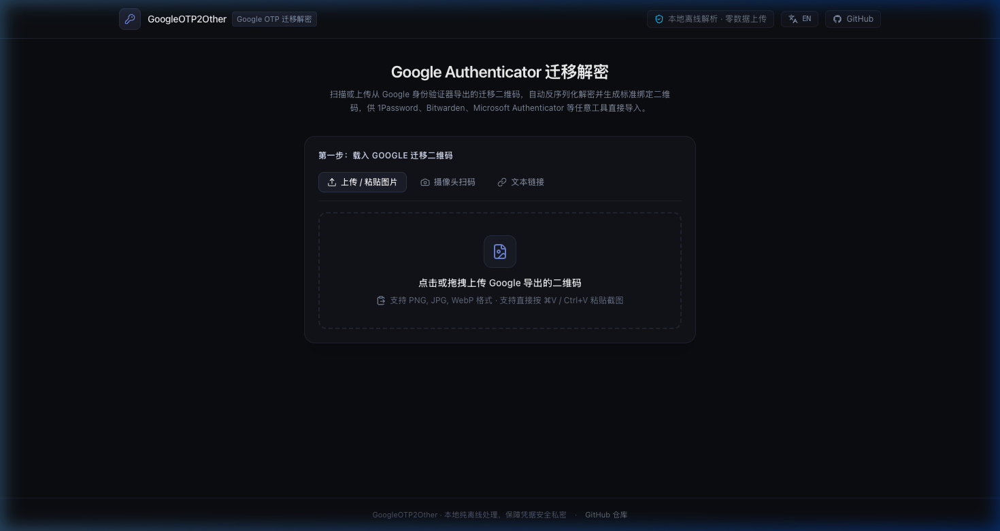
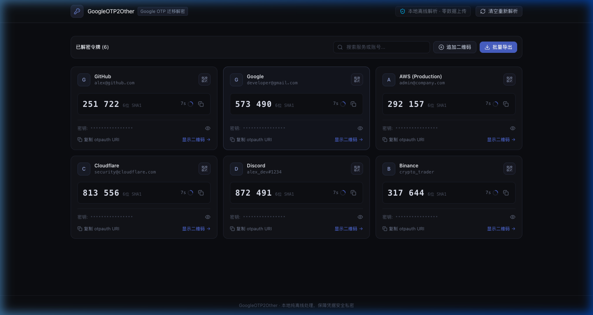
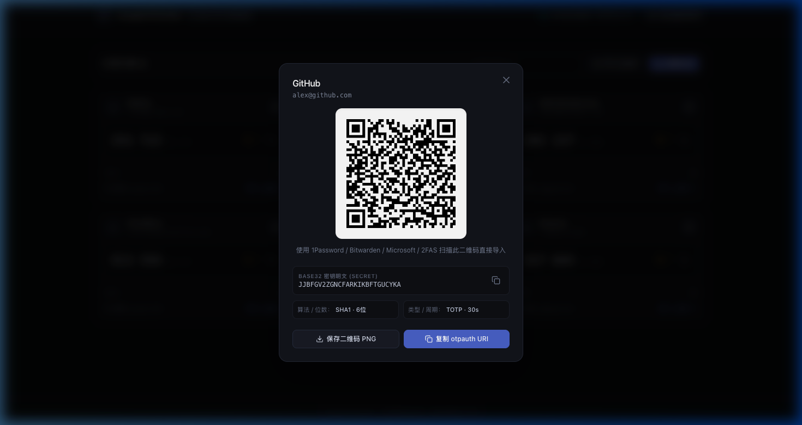

# GoogleOTP2Other

<p align="left">
  <b><a href="README.md">简体中文</a></b> | <b><a href="README_en.md">English</a></b>
</p>

> Google Authenticator 迁移解密与通用二维码转换工具。

[](LICENSE)
[](https://github.com/Nash-x9/GoogleOPT2Other)
[](https://github.com/Nash-x9/GoogleOPT2Other/actions/workflows/deploy.yml)

### 一键部署到免费平台

[](https://deploy.workers.cloudflare.com/?url=https://github.com/Nash-x9/GoogleOPT2Other)
&nbsp;
[](https://vercel.com/new/clone?repository-url=https://github.com/Nash-x9/GoogleOPT2Other)
&nbsp;
[](https://app.netlify.com/start/deploy?repository=https://github.com/Nash-x9/GoogleOPT2Other)

---

支持扫描或上传 Google Authenticator 导出的迁移二维码，在浏览器本地离线解密 Protobuf 载荷，还原标准 Base32 密钥，并实时生成标准 TOTP/HOTP 绑定二维码，供 1Password、Bitwarden、Microsoft Authenticator、2FAS、Aegis 等双重认证工具直接导入。

---

## 界面预览

### 1. 输入与载入界面
支持屏幕截图直接粘贴（⌘V / Ctrl+V）、图片拖拽上传、摄像头实时扫码及文本链接解析：



### 2. 二维码扫描解密后界面
自动解析出全部 OTP 账号，实时计算 30 秒动态口令及进度倒计时，支持搜索、多批次追加合并与批量导出：



### 3. 单个账号二维码与详情
点击任意账号即可查看标准 TOTP 绑定二维码，供 1Password、Bitwarden、2FAS 等应用直接扫码绑定，或一键复制密钥与 otpauth URI：



---

## 免费静态托管与一键部署

本项目所有数据加解密与动态计算均在浏览器端完成，支持各平台自动拉取源码在线构建。点击下方任意图标即可直达对应平台快速上线：

| 托管平台 | 一键部署图标 | 说明与配置支持 |
| :--- | :--- | :--- |
| **GitHub Pages** | [](https://github.com/Nash-x9/GoogleOPT2Other/fork) | **必须先在仓库开启 Pages**（见下方说明）。通过 [`.github/workflows/deploy.yml`](.github/workflows/deploy.yml) 源码在线构建发布 |
| **Cloudflare Workers / Pages** | [](https://deploy.workers.cloudflare.com/?url=https://github.com/Nash-x9/GoogleOPT2Other) | 免费全球 CDN 加速。已预置 [`wrangler.toml`](wrangler.toml) 与 [`wrangler.jsonc`](wrangler.jsonc) |
| **Vercel** | [](https://vercel.com/new/clone?repository-url=https://github.com/Nash-x9/GoogleOPT2Other) | 自动拉取源码编译。已预置 [`vercel.json`](vercel.json) |
| **Netlify** | [](https://app.netlify.com/start/deploy?repository=https://github.com/Nash-x9/GoogleOPT2Other) | 一键连接 Git 仓库自动编译。已预置 [`netlify.toml`](netlify.toml) |

### GitHub Pages 部署必读说明

> [!WARNING]
> **前置要求（必须手动开启）**：
> GitHub 仓库默认并未启用 Pages 服务。如果未手动开启，直接触发 Actions 会因无权限而报错（`HttpError: Not Found`）。
> **正确开启步骤：**
> 1. 进入仓库右上角 **Settings** -> 左侧菜单 **Pages**。
> 2. 在 **Build and deployment** > **Source** 下拉选择框中，将默认的 `Deploy from a branch` 修改为 **`GitHub Actions`**。
> 3. 保存后，后续推送代码或在 Actions 页面手动点击 **Run workflow** 即可全自动构建并部署成功。

### Cloudflare 命令行手动部署

<details>
<summary><b>展开查看 Wrangler CLI 手动部署命令</b></summary>

```bash
# 1. 本地安装依赖并编译生成 dist
pnpm install
pnpm build

# 2. 使用 Wrangler 直接上传至 Cloudflare Pages
npx wrangler pages deploy dist --project-name=googleotp2other
```

</details>

---

## 核心特性

- **纯客户端离线处理**：所有二维码识别、Protobuf 反序列化、Base32 编解码及 TOTP 动态码计算均在浏览器端完成，无任何网络请求，敏感凭据不出本地。
- **单文件便携构建**：本地构建后生成一个完全独立的 `index.html`，无需任何 Web 服务器，双击即可完全离线使用。
- **多种导入方式**：支持屏幕截图粘贴（Ctrl+V / ⌘V）、图片拖拽上传、摄像头实时扫码，或直接输入 `otpauth-migration://` 链接。
- **多批次合并导出**：Google 导出的账号较多时会自动生成多张二维码，支持连续追加扫描合并。
- **动态码实时校验**：内置 RFC 6238 标准 TOTP 引擎，实时计算 30 秒动态口令及倒计时进度，便于与原手机数据比对确认。
- **批量导出支持**：支持逐个查看高清晰度二维码扫码导入，同时提供一键导出为标准 JSON、CSV、TXT (otpauth URI 列表) 格式。

---

## 使用指南

### 步骤 1：从 Google Authenticator 导出二维码
1. 打开手机中的 **Google Authenticator** 应用。
2. 点击右上角菜单，选择 **转移账号** -> **导出账号**。
3. 验证身份后勾选需要导出的账号，点击 **下一步**。
4. 屏幕上将生成一个或多个迁移二维码（若账号较多，会分页展示）。

### 步骤 2：在 GoogleOTP2Other 中解析
- **方式 A（截图粘贴）**：截图后直接在 GoogleOTP2Other 页面按下 `Ctrl + V` 或 `⌘ + V` 粘贴。
- **方式 B（上传图片）**：将二维码图片拖拽至上传区域，或点击选择文件。
- **方式 C（摄像头扫码）**：点击「摄像头扫码」，将手机上的二维码对准取景框。
- **方式 D（链接解析）**：若已有解码出的 `otpauth-migration://offline?data=...` 文本，可在「文本链接」选项卡中直接粘贴。

### 步骤 3：导入至目标认证工具
- **扫码导入**：在列表中点击目标账号的「显示二维码」，使用其他 OTP 工具（如 1Password、Bitwarden、2FAS）扫描该二维码即可完成绑定。
- **批量导入**：点击工具栏的「批量导出」，下载包含所有账户信息的 JSON 文件或复制所有 `otpauth://` 链接，直接导入至支持批量导入的应用中。

---

## 本地开发与构建

### 环境要求
- Node.js >= 20
- pnpm >= 9

### 1. 本地启动开发环境
```bash
# 安装依赖
pnpm install

# 启动本地开发服务
pnpm dev
```
启动后在浏览器访问 `http://localhost:5173`。

### 2. 本地构建纯静态单文件
```bash
pnpm run build
```
执行后会在本地生成一个完全自包含的 **`dist/index.html`** 文件：
- **离线便携**：直接双击打开该 HTML 文件即可使用，即使拔掉网线也能完全离线运行。
- **静态托管**：可直接上传至 Cloudflare Pages、GitHub Pages、Vercel，或放置在任意 Nginx / Apache 静态目录下。

---

## 兼容工具列表

解析后生成的标准 `otpauth://` URI 与二维码完全符合 RFC 6238 (TOTP) / RFC 4226 (HOTP) 规范，兼容以下工具：

- 1Password
- Bitwarden / Vaultwarden
- Microsoft Authenticator
- 2FAS Authenticator
- Aegis Authenticator
- Ente Auth
- KeePassXC
- Apple 密码与钥匙串 (iOS / macOS 内置双重验证)

---

## 开源协议

本项目基于 [Apache License 2.0](LICENSE) 协议开源。
